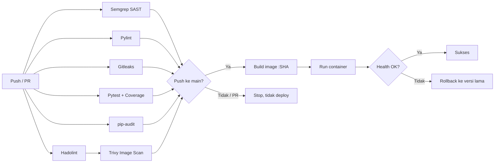

# Belajar DevSecOps Pipeline (Versi Pengembangan)

Pengembangan dari modul **P12 – Implementasi Pipeline CI/CD Dasar dengan GitHub Actions**.
Pipeline asli (Semgrep + Pylint + Deploy ke VM) dipertahankan, lalu ditambah **5 job keamanan/kualitas baru** dan **CD yang lebih aman** (health check + auto-rollback).

## Ringkasan Tambahan

| No | Tambahan | Tool | Kenapa Penting |
|---|---|---|---|
| 1 | Secret Scanning | Gitleaks | Mencegah password, API key, atau token ikut ter-commit. |
| 2 | Unit Test + Coverage Gate | Pytest + pytest-cov | Memastikan fitur berjalan benar (termasuk uji anti SQL Injection). Gagal jika coverage < 80%. |
| 3 | Dependency Scan (SCA) | pip-audit | Mengecek library di `requirements.txt` terhadap database CVE. |
| 4 | Dockerfile Lint | Hadolint | Mendeteksi praktik buruk pada Dockerfile. |
| 5 | Container Image Scan | Trivy v0.69.3 | Memindai CVE pada OS & library di dalam image sebelum deploy. |
| 6 | Deploy hanya dari `main` | kondisi `if:` | Di modul asli deploy ikut jalan saat Pull Request, jadi kode yang belum di-review bisa ter-deploy. |
| 7 | Image tag = commit SHA | Docker | Setiap versi bisa dilacak dan dipakai untuk rollback. |
| 8 | Health Check + Auto-Rollback | endpoint `/health` | Jika aplikasi baru gagal hidup, otomatis kembali ke versi sebelumnya. |
| 9 | Least privilege & concurrency | `permissions`, `concurrency` | Token GitHub hanya read; dua deploy tidak bisa bertabrakan. |
| 10 | Ringkasan deploy & artefak | `GITHUB_STEP_SUMMARY`, upload-artifact | Hasil deploy dan laporan coverage tampil di halaman Actions. |

**Perbaikan pada aplikasi:**
- Password disimpan sebagai **hash** (werkzeug), bukan teks biasa.
- Kolom `username` diberi `PRIMARY KEY`. Di modul asli `INSERT OR IGNORE` tidak berfungsi sehingga data admin terduplikasi setiap restart.
- Endpoint baru `GET /health` untuk health check.
- Dockerfile: `python:3.12-slim` (3.10 sudah end-of-life Oktober 2026), `HEALTHCHECK`, `.dockerignore`.

## Alur Pipeline



## Struktur Proyek

```
belajar-devsecops-pipeline/
├── .github/workflows/devsecops.yml   # pipeline CI/CD
├── templates/index.html              # halaman login
├── tests/test_app.py                 # unit test (tambahan)
├── app.py                            # aplikasi Flask (versi aman)
├── Dockerfile
├── .dockerignore                     # (tambahan)
├── .gitignore                        # (tambahan)
├── .gitleaks.toml                    # konfigurasi Gitleaks (tambahan)
├── pytest.ini                        # (tambahan)
├── requirements.txt                  # flask==3.1.3
└── requirements-dev.txt              # pytest, pytest-cov, pylint, pip-audit (tambahan)
```

## Menjalankan Pengecekan di Laptop (opsional)

```bash
python -m venv venv
venv\Scripts\activate            # Windows  (Linux/Mac: source venv/bin/activate)
pip install -r requirements.txt -r requirements-dev.txt
pytest --cov=app --cov-fail-under=80
pylint --fail-under=9.0 app.py tests/
pip-audit -r requirements.txt
```

## Catatan Keamanan

- **Trivy dipin ke `0.69.3`** dan dijalankan via image Docker resmi, bukan `aquasecurity/trivy-action`. Pada Maret 2026 ekosistem Trivy terkena serangan supply-chain (CVE-2026-33634); v0.69.4 dan banyak tag `trivy-action` disusupi malware. Versi 0.69.2/0.69.3 dinyatakan aman.
- **Self-hosted runner + repo publik** berisiko karena siapa pun bisa membuat PR dari fork. Karena itu job deploy (satu-satunya yang memakai self-hosted runner) **tidak pernah berjalan pada Pull Request**.
- `.gitleaks.toml` memasukkan `README.md` ke allowlist sebagai contoh tuning false positive.
- Password admin bisa diganti lewat environment variable `ADMIN_PASSWORD` (default `supersecret` hanya untuk praktikum).
